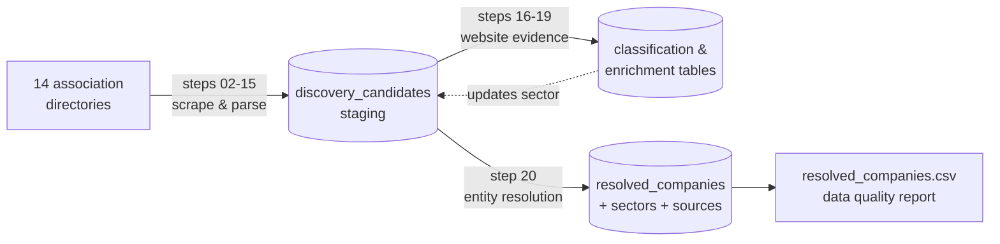

# Animal Farming Companies in Germany

A data pipeline that builds a **single, deduplicated database of companies
across Germany's animal farming value chain**: feed, animal health, breeding
and genetics, livestock equipment, farms, slaughtering, meat processing and
dairy. It does this by collecting and cleaning the member directories of
14 industry associations.

## The problem

Germany has one of Europe's largest livestock sectors, but there is no public,
structured list of the companies working in it. The information exists,
scattered across association websites, each with its own layout, coverage and
gaps. The same company often appears in several directories under slightly
different names, and many listed members (e.g. crop machinery makers) are not
related to livestock at all.

This project turns those scattered sources into one queryable dataset that
answers questions such as *which companies operate in pig genetics?*,
*which dairy processors are confirmed by more than one source?* or
*where in Germany is the industry concentrated?* It is designed as the
foundation for analysing employers in the sector: the target schema already
contains tables for verified company profiles, sites and job openings.

## Results

| | |
|---|---|
| Sources scraped | 14 association directories |
| Company records collected | 1,168 |
| Distinct companies after entity resolution | 950 (19% of records were duplicates) |
| Companies confirmed by 2+ independent sources | 123 |
| Malformed values found by the quality audit | 9 (all errors on the source websites) |

The full audit, with tables, charts and findings, is in
[notebooks/data_quality_report.ipynb](notebooks/data_quality_report.ipynb).

## Pipeline



| Step | Script | What it does |
|---|---|---|
| 01 | `01_initialize_database.py` | Create the SQLite database from [sql/schema.sql](sql/schema.sql) |
| 02–15 | `NN_discover_*.py` | One script per source: download, parse, validate, save to CSV and the staging table |
| 16–17 | `16_classify_…`, `17_enrich_…` | Read machinery makers' websites and label them by livestock relevance (keywords) |
| 18 | `18_enrich_dairy_export_contacts.py` | Fill missing contact details from company profile pages |
| 19 | `19_qualify_livestock_producers.py` | Label farms by the animals their website mentions |
| 20 | `20_resolve_companies.py` | Merge duplicates across sources into one row per company and export the final CSV |

### Sources

| Step | Source | Sector | Records |
|---|---|---|---:|
| 02 | DVT (feed industry association) | Animal feed and nutrition | 211 |
| 03 | BfT (animal health association) | Animal health | 24 |
| 04 | VDMA Landtechnik (machinery association) | Agricultural machinery | 155 |
| 05 | BRS (cattle and pig association) | Cattle and pig value chain | 181 |
| 06 | NGW (poultry association) | Poultry value chain | 10 |
| 07 | MIV (dairy industry association) | Dairy processing | 170 |
| 08 | Export-Union (dairy exporters) | Dairy value chain | 175 |
| 09 | VDF (meat industry), slaughtering | Slaughtering | 65 |
| 10 | BVWS (sausage and ham producers) | Meat processing | 101 |
| 11 | DRV (Raiffeisen cooperatives), livestock committee | Livestock marketing | 18 |
| 12 | ASR (cattle breeding organisations) | Cattle breeding and genetics | 23 |
| 13 | FBF (breeding research association), pig section | Pig breeding | 7 |
| 14 | Schweinebesamung Weser-Ems, partners | Pig genetics | 7 |
| 15 | IMA livestock project farms (corporate only) | Livestock farms | 21 |

## Design decisions

- **Staging, then resolution.** Every source writes raw records to one staging
  table with a shared format. Merging happens once, at the end, so a source can
  be re-scraped at any time without breaking anything downstream.
- **Idempotent loads.** Each staging row is unique on *(source, company,
  address)*, and every load is an upsert. A rerun updates rows and never
  duplicates them. A blank value never overwrites a stored one, so a source
  without phone numbers cannot erase a phone number found by another step.
- **Fail loudly on layout changes.** Each parser checks that it found the
  expected page structure and a plausible number of records. If a website
  changes, the step stops instead of silently saving half the data.
- **Polite, rule-following scraping.** One reused HTTP session, a pause
  between requests, retries with growing back-off, and robots.txt checks
  (including on redirects) before any company website is read.
- **Transparent classification.** Relevance labels come from keyword lists
  that are readable in the code, and every label is stored with its evidence
  (matched keywords and URLs), so each decision can be audited.
- **Lineage.** Every resolved company links back to the exact staging rows and
  sources it was built from.

## Project structure

```
├── data/
│   ├── raw/                 # one CSV per source (output of steps 02-15)
│   ├── processed/           # classification evidence and the final company list
│   └── database/            # SQLite database (not committed; rebuilt by the pipeline)
├── notebooks/
│   └── data_quality_report.ipynb
├── scripts/
│   ├── common.py            # shared helpers: HTTP, parsing, validation, storage
│   ├── run_pipeline.py      # runs the steps in order
│   └── 01_ … 20_*.py        # one script per pipeline step
├── sql/
│   └── schema.sql           # every table, with comments
└── requirements.txt
```

## How to run

```bash
python -m venv .venv
.venv\Scripts\activate            # Windows  (macOS/Linux: source .venv/bin/activate)
pip install -r requirements.txt
python -m playwright install chromium

python scripts/run_pipeline.py          # all steps, 01 to 20
python scripts/run_pipeline.py 16 20    # only steps 16 to 20
python scripts/07_discover_dairy_companies.py   # a single step
```

A full run takes about 30–45 minutes, mostly because of the deliberate pauses
between requests. Then open the notebook to see the quality report.

## Known limitations

- **Keyword classification has low recall.** 128 of 155 machinery makers
  remain "unknown", either because their website could not be read or because
  it does not use the keywords. A text classifier or manual review would help.
- **Crop-only detection in step 19 never fires.** The text is casefolded,
  which turns "ß" into "ss", so the patterns containing "ausschließlich" cannot
  match. The fix is one line; it is left out so that the published results stay
  reproducible.
- **Name-based matching.** Entity resolution matches on normalised names, so
  "Company GmbH" and "Company Deutschland GmbH" stay separate. Companies that
  share a website domain are listed for manual review.
- **Source errors are kept as published.** The audit found 3 foreign BRS
  members and 6 malformed contact values. They are documented in the notebook
  rather than silently changed.

## Roadmap

- Fill the target model (`companies`, `locations`, `jobs`) with verified
  profiles, company size and current job openings.
- Add a cleaning step for the source errors found by the audit.
- Replace the keyword lists with a trained text classifier and measure its
  precision and recall against a labelled sample.
